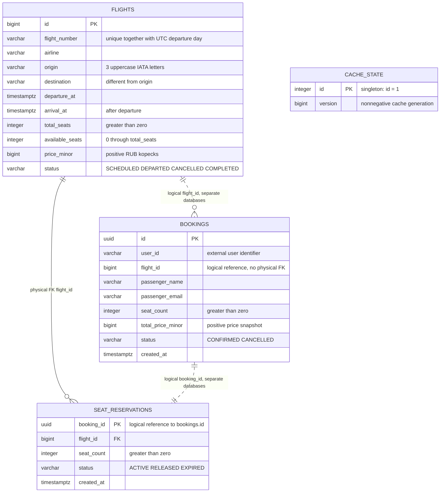

# Схема данных и 3NF

`flights`, `seat_reservations` и `cache_state` находятся в БД `flight`, `bookings` — в БД `booking`, на двух отдельных серверах PostgreSQL. Пунктирные связи — бизнес-инварианты, а не физические внешние ключи. PostgreSQL не обеспечивает FK между этими БД. При нормальном завершении создания бронь имеет ровно одну резервацию; при межсервисных сбоях возможны расхождения, описанные в [контракте](api.md).

**Ключи и ограничения.** PK — первичный ключ, уникально идентифицирует строку. `booking_id` одновременно идентификатор резервации: отдельный искусственный `reservation_id` не нужен. FK — внешний ключ, проверяет существование рейса в той же БД. Удаление рейса с резервациями запрещено стандартным поведением FK. Индекс `flight_number_day` обеспечивает уникальность `(flight_number, дата departure_at в UTC)`, даже если время вылета отличается. Все поля обязательны. Проверки CHECK ограничивают места, цены, маршрут, порядок времён и значения статусов. Поиск и список бронирований имеют отдельные индексы.

**Первая нормальная форма.** Поля атомарны: в одной ячейке нет списка пассажиров или аэропортов. Бронь имеет одного контактного пассажира и количество мест согласно заданию; персональные данные каждого пассажира не моделируются.

**Вторая нормальная форма.** Первичные ключи одноатрибутные. Каждый неключевой атрибут зависит от всего ключа. Альтернативный ключ рейса — номер и UTC-день вылета, определяющие конкретное выполнение рейса.

**Третья нормальная форма.** Неключевые атрибуты не определяют другие неключевые атрибуты. Здесь `airline` — текстовый атрибут конкретного рейса; справочника номеров, фиксирующего зависимость `flight_number → airline`, нет. Номер рейса не считается глобальным кодом авиакомпании. Аналогично `user_id` не определяет данные пассажира: один пользователь может бронировать для разных людей, а имя/email — снимок контакта конкретной брони. Если добавить справочник авиакомпаний, аэропортов или профили пользователей, их атрибуты следует вынести в отдельные таблицы.

Цена брони — исторический снимок, не копия изменяемой текущей цены рейса. В `bookings` не сохраняется дополнительно цена единицы: `seat_count` сам по себе не определяет сумму. Поле даты вылета отдельно не хранится, чтобы не дублировать функцию от `departure_at`; уникальность дня выражена индексом.

**Счётчик мест.** `available_seats` хранится по условию задачи. Это материализованный агрегат, который должен совпадать с `total_seats − SUM(seat_count активных резерваций)`. Формальные зависимости внутри таблиц соответствуют 3NF, но согласованность агрегата с другой таблицей поддерживают транзакции приложения, а не CHECK. Прямые SQL-изменения в обход сервиса способны нарушить этот инвариант.

**Версия кеша.** `cache_state` — служебная таблица из одной строки. Значение `version` меняется в той же транзакции, что рейс или резервация. `id → version`, неключевых транзитивных зависимостей нет. Общая версия позволяет проверить актуальность Redis-значения после переключения на реплику. При чтении берётся FOR SHARE, при изменении — FOR UPDATE; это сериализует мутации и исключает запись старого значения в кеш после инвалидирования.
